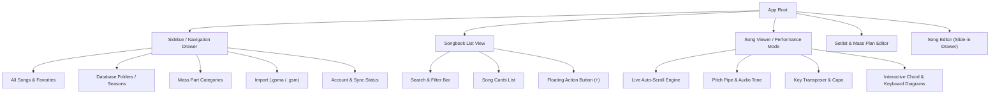

# Choir Book Pro — Architecture & Design Blueprint

## 1. Executive Summary & Product Vision
Choir Book Pro is a cross-platform choir songbook and liturgical service planning application designed for zero-latency live performance, offline reliability, and continuous cloud synchronization. It operates seamlessly as a Progressive Web App (PWA) and as an Android native app via Capacitor.

---

## 2. Information Architecture & Navigation

---

## 3. Storage & Cloud Database Architecture

### Dual-Layer Storage Pattern
1. **Local Layer (Immediate Frame-0 Access)**
   - Browser `localStorage` / IndexedDB caching.
   - Boot sequence reads local cache instantly for 0ms cold starts before network initialization.
2. **Cloud Layer (Cloud Firestore)**
   - Scope: `users/{userId}/data/{documentId}`
   - Real-time two-way synchronization via Firestore `onSnapshot`.
   - Security rule enforces strict per-user authentication boundaries while supporting anonymous guest accounts.

### Data Schemas

#### Song Document (`song:<uuid>`)
| Field | Type | Description |
|---|---|---|
| `id` | String | Unique UUID identifier |
| `title` | String | Song title |
| `artist` | String | Composer or artist attribution |
| `key` | String | Musical key (e.g., G, D, Bb) |
| `capo` | Number | Capo fret offset (0-11) |
| `tempo` | Number | Beats per minute (BPM) |
| `timeSig` | String | Time signature (e.g., 4/4, 3/4, 6/8) |
| `style` | String | Hymn, Praise, Chant, Contemporary |
| `instrument` | String | Guitar, Vocal, Keyboard |
| `categories` | String[] | Assigned folder/season labels |
| `massParts` | String[] | Liturgical parts (Entrance, Gloria, Communion) |
| `favorite` | Boolean | Starred status |
| `transposeOffset`| Number | Semitone transposition offset |
| `viewerFontSize` | Number | Saved typography size for stage viewing |
| `viewerScrollSpeed`| Number | Auto-scroll rate in pixels/sec |
| `body` | String | Lyrics with space-aligned or bracketed chord notations |
| `dateAdded` | Number | Timestamp epoch in milliseconds |

#### Setlist / Mass Plan Document (`setlist:<uuid>`)
| Field | Type | Description |
|---|---|---|
| `id` | String | Unique plan identifier |
| `name` | String | Event or liturgy name (e.g., Sunday 10am Mass) |
| `date` | String/Null | Planned liturgy calendar date |
| `isTemplate` | Boolean | Flag indicating reusable liturgy template |
| `basedOnTemplateId`| String/Null | Source template reference |
| `items` | Array | Ordered collection of section headers and songs |

#### Meta Documents (`meta:categories`, `meta:massparts`)
- `meta:categories`: Stored JSON array of folder names synced across client instances with inline rename and delete capability.
- `meta:massparts`: Stored JSON array of liturgical liturgy segments.

---

## 4. UI / UX Design System

### Color Palette & Visual Hierarchy
- **Canvas / Background**: `#0b0f17` (Deep Obsidian for high-contrast dark environments)
- **Elevated Surfaces**: `#161f30` (Cards), `#1e2b42` (Modal dialogs & drawers)
- **Primary Accent**: `#38bdf8` (Vibrant Sky Blue for active states & database indicators)
- **Chord & Highlight Accent**: `#fbbf24` (Golden Amber for musical chords, pitch pipes, and Mass parts)
- **Destructive Action**: `#ef4444` (Muted crimson for confirmations)
- **Typography**: `Manrope` (Clean geometric UI) paired with `JetBrains Mono` (Monospaced alignment for chords above lyrics)

### Screen Modules
1. **List & Catalog Screen**: Rapid filtering by search query, folder, liturgical season, or Mass part with instant count indicators.
2. **Performance Viewer Screen**: Fullscreen distraction-free view with key transpose chips, BPM metronome flash, pitch-pipe reference tone generator, and smooth hands-free auto-scroller.
3. **Setlist & Liturgy Planner**: Drag-and-drop / up-down sequence reordering, Mass section markers, and direct rehearsal viewer navigation.
4. **Folder Management System**: Cloud database-backed folder creation, inline rename modal, and safe cascading deletion.

---

## 5. Development & Deployment Pipeline

- **Directory Organization**:
  - `css/`: Modular styling specifications (`css/style.css`)
  - `js/`: Modular application logic (`js/app.js`, `js/firebase-config.js`, `js/sw.js`)
  - `icons/`: High-resolution PWA & launcher icons
  - `android/`: Native Android Studio Capacitor wrapper project
  - `graphify-out/`: Automated knowledge graph & AST documentation
- **Build & Sync Scripts**:
  - `npm run build`: Cleans and copies web assets into `www/`
  - `a.bat`: One-touch build, Capacitor sync, and Android Studio launcher
  - `g.bat`: Automated GitHub repository sync and staging

---

## 6. Scalability & Extensibility Roadmap

- [x] Cloud Firestore database configuration with security rules
- [x] Dual storage adapter (Firestore cloud + offline local cache)
- [x] Clean folder architecture (`js/` and `css/`)
- [x] Database-backed folders with inline rename and deletion
- [x] Offline Service Worker app-shell cache
- [ ] Export setlist or songbook to formatted printable PDF
- [ ] Direct Bluetooth pedal integration for hands-free page turning
- [ ] Multi-choir team sharing with role-based permissions (Director vs Member)
- [ ] Audio pitch pipe synthesizer using Web Audio API oscillator

